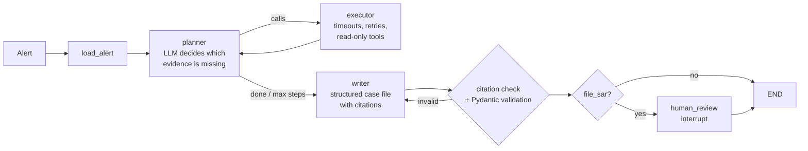

# Fraud Case Investigation Agent

Given a flagged transaction, this agent gathers evidence with tools, reasons over it, and writes an
analyst-ready case file with a recommended disposition (**close**, **escalate**, or **file SAR**). Every
statement in the case file cites the tool result behind it, and every SAR recommendation pauses for human
approval. An evaluation harness measures how often the agent gets the disposition right, compared with a
single-prompt baseline and a ReAct agent.

> All data is **synthetic**. No real customer, bank, or employer data is used.

<!-- TODO: record a GIF of the Streamlit app, save it as docs/demo.gif, and uncomment:
 -->

## Results

<!-- TODO: replace with your numbers from `make eval` (results/results.md). Do not publish mock-mode numbers. -->

| System | Disposition acc. | Task completion | Tool recall | Hallucination rate | Latency p95 | Cost / case |
|---|---|---|---|---|---|---|
| Single prompt (no tools) | _run eval_ | | | | | |
| ReAct agent | _run eval_ | | | | | |
| **LangGraph planner (this project)** | _run eval_ | | | | | |

Evaluated on 140 synthetic alerts with planted ground truth, model `gpt-4o-mini` (configurable).

## Architecture



**Tools** (all read-only, all wrapped with a timeout, retry with backoff, and an error record instead of an exception):

| Tool | What it returns |
|---|---|
| `sql_lookup` | Rows for the alerted account from a whitelisted table (transactions, logins, payees, devices, accounts, customers, prior alerts) within a look-back window |
| `risk_score` | XGBoost fraud score for the alerted transaction plus the top SHAP drivers |
| `policy_search` | Top policy sections from 12 internal policy docs (Chroma + OpenAI embeddings, or offline TF-IDF) |
| `network_check` | Accounts sharing a device, IP, or recent payee, plus 24h inflow, outflow, and pass-through ratio |
| `typology_classifier` | Optional: the fine-tuned model from [fraud-typology-extractor](https://github.com/Keerthana-2003/fraud-typology-extractor) |

## Guardrails

- **SQL is read-only and parameterized.** The LLM never writes SQL. It chooses a whitelisted table and a time
  window; the query is built with bound parameters on a connection opened in SQLite read-only mode. Label
  columns (`is_fraud`, ground truth) are never exposed.
- **Structured outputs are validated with Pydantic.** Invalid output is sent back to the model with the
  validation error, up to `MAX_OUTPUT_REPAIRS` times.
- **Every claim must cite evidence.** An automatic check rejects claims citing evidence IDs that don't exist
  or came from a failed tool, and sends them back for repair. Decimal numbers not found in the cited evidence are
  flagged separately.
- **PII is masked** (names, emails, phones, dates of birth, full account numbers) before anything reaches the LLM.
- **Graceful degradation.** A failing tool becomes an error record the writer must acknowledge ("risk model
  unavailable"). If the LLM fails entirely, a deterministic rules engine produces a low-confidence case file.
- **Bounded loops.** `AGENT_MAX_STEPS` and `AGENT_MAX_CALLS_PER_STEP` cap cost; the planner can't repeat a call.
- **Human in the loop.** `file_sar` recommendations pause the graph with `interrupt()` until an analyst approves or rejects.

## Data and ground truth

`python -m fraud_agent.data_gen` builds a synthetic bank (1,500 customers, ~59K transactions, ~30K logins)
and plants known patterns, so every alert has a correct answer:

| Planted pattern | Alerts | Correct disposition | Policy rule |
|---|---|---|---|
| Account takeover (new device + password reset + new payee + large transfer) | 25 | escalate | ATO-1 |
| Card testing (10+ charges under $5 across 3+ merchants in an hour) | 25 | escalate | CT-1 |
| Money mule ring (shared device, 80%+ of inflow moved out within 24h) | 25 | file_sar | MM-1 |
| Structuring (3+ cash deposits of $8,000-$9,999 in 7 days) | 25 | file_sar | ST-1 |
| Benign look-alikes (travel, known payee, transit taps, cash business, salary then rent) | 40 | close | - |

The benign look-alikes trigger the same alert rules as the fraud cases, and the risk model often scores them
high, so the agent has to read the evidence and policies rather than trust the score.

The risk model is trained on a **separate** synthetic dataset (different random seed) to avoid leakage into the
evaluation alerts.

## Quickstart

```bash
cp .env.example .env            # add OPENAI_API_KEY (or ANTHROPIC_API_KEY + LLM_PROVIDER=anthropic)
docker compose up --build       # http://localhost:8501
```

Without Docker:

```bash
python -m venv .venv && source .venv/bin/activate
make install                    # dependencies + package
make setup                      # synthetic data, risk model, policy index
make app                        # Streamlit demo
python -m fraud_agent.graph A000001 --interactive    # one alert in the terminal
```

Run the tests offline (no API key needed):

```bash
make test
```

## Evaluation

```bash
make eval-quick     # 20 random alerts, all three systems
make eval           # all 140 alerts -> results/results.md, results/summary.json, results/cases.csv
```

| Metric | Definition |
|---|---|
| Disposition accuracy | Share of alerts with the correct close / escalate / file_sar |
| Typology accuracy | Share with the correct fraud typology |
| Task completion | Valid case file, citation check passed, no fallback used |
| Tool recall | Share of the tools required for that alert type that were actually called |
| Avg steps / tool calls | Planner iterations and tool calls per case |
| Hallucination rate | Claims citing missing or failed evidence, divided by all claims |
| Latency, cost | Wall-clock per case (mean and p95) and token cost at list prices in `config.py` |

Baselines: **single prompt** gets a fixed bundle of recent records in one call (no tools, no policies);
**ReAct** is LangGraph's prebuilt agent with the same tools and guardrails, but no planner, evidence state, or
citation repair loop.

Set `LANGSMITH_TRACING=true` and `LANGSMITH_API_KEY` to trace every run in LangSmith.

## Design decisions

- **LangGraph over CrewAI.** The workflow is a fixed control flow with one loop and one approval gate. LangGraph
  makes that explicit, checkpoints state for the human-review pause, and is easy to test node by node.
- **Planner + executor instead of plain ReAct.** The planner sees a compact view of evidence already collected
  and can request several tools at once, which keeps the context smaller and makes repeated calls impossible.
- **Flat tool-call schema.** Optional fields (`table`, `since_hours`, `query`) instead of free-form JSON args
  work with OpenAI and Anthropic function calling alike and are easy to validate.
- **Structured SQL instead of text-to-SQL.** Lower flexibility, but the attack surface is a whitelist, not a parser.
- **Offline mock mode.** `LLM_PROVIDER=mock` runs the whole graph with a rules-based stand-in so tests and CI
  need no API key. Mock numbers verify the pipeline only and are labeled as such.

## Known limitations and next steps

- Synthetic data: patterns are cleaner than real fraud. Next: add noisier and mixed typologies.
- The citation check verifies that cited evidence exists, not that it semantically supports the claim. Next: an
  LLM-as-judge or NLI check on a sample.
- Single-account scope. Next: let the agent pivot to linked accounts found by `network_check`.
- Plug in the fine-tuned `typology_classifier` from Project 2 and measure its effect.

## Project layout

```
src/fraud_agent/
  data_gen.py     synthetic bank + planted fraud patterns + alerts with ground truth
  risk_model.py   point-in-time features, XGBoost training, TreeSHAP explanations
  db.py           read-only, whitelisted, parameterized queries; network check
  retriever.py    policy search (Chroma or TF-IDF)
  tools.py        tool implementations + timeout / retry / degradation wrapper
  schemas.py      Pydantic schemas for tool calls, planner decisions, case files
  nodes.py        planner, executor, writer, citation check, review logic
  graph.py        LangGraph wiring, interrupt-based human review, CLI
  baselines.py    single-prompt and ReAct baselines
  evaluate.py     evaluation harness and results table
  rules.py        deterministic policy rules (mock LLM + fallback)
app.py            Streamlit demo
data/policies/    12 synthetic policy documents
```

## License

MIT
